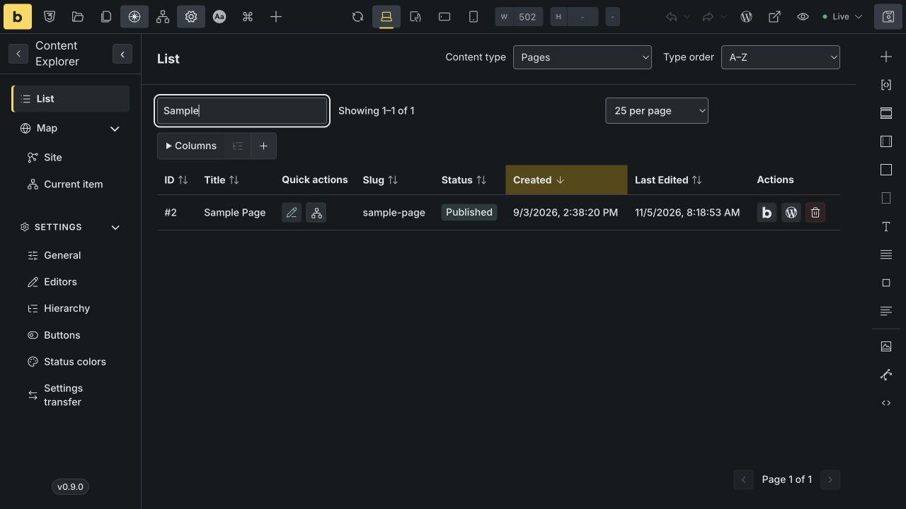
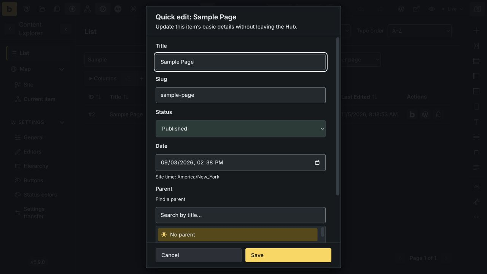
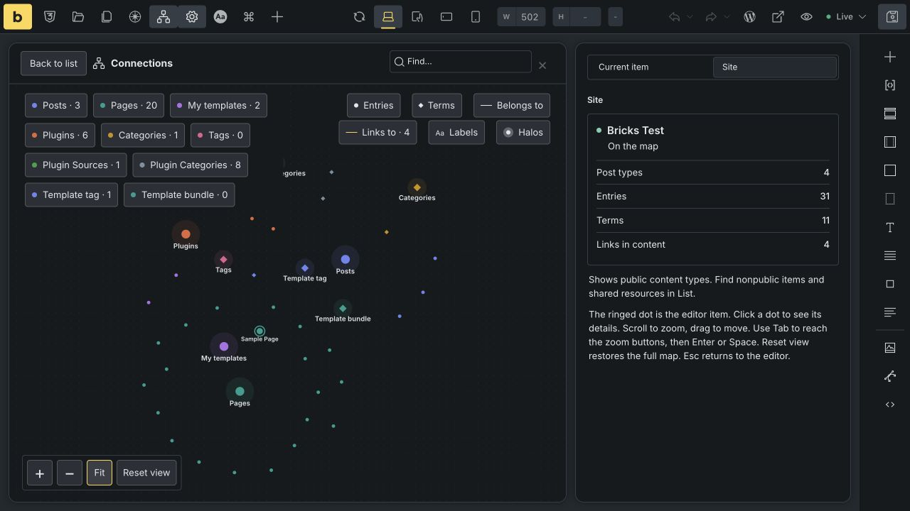

# Content Explorer for Bricks

Browse, search, edit, and map WordPress content from a workspace for Bricks Builder.

<!-- wporg-description:start -->
Content Explorer for Bricks provides searchable content lists, hierarchy, sorting, pagination, quick editing, taxonomy tools, and visual maps of saved links and shared resources.

Open Content Explorer in WordPress administration or use the compass and connections icons in the Bricks toolbar. Builder links open another tab to preserve the current document's unsaved work.

The Bricks adapter reads saved element metadata for internal links, literal local URLs, rich text links, and Template elements. It does not execute dynamic data, loops, shortcodes, or custom code. ACF and Meta Box relationship fields are supported where installed.

Version 0.9.0 adapts Content Explorer for Etch 2.2.2. Bricks components and condition-based template assignments are not included. Bricks Builder is not bundled. This plugin is not affiliated with or endorsed by Bricks.

All assets ship locally. There are no plugin telemetry requests, remote asset services, or external update checks. Production updates are intended for WordPress.org after directory approval.
<!-- wporg-description:end -->

Current candidate: **0.9.4**, including Quick edit contrast, caret spacing, native button states, and unified map search styling. Requires WordPress **7.0+**, PHP **8.4+**. Tested up to WordPress **7.2**. The ZIP has completed local checks and official readme validation. Submitted to WordPress.org on Nov. 25, 2026; the original automated scan passed, and the review package was updated to 0.9.4. Manual review is pending. See [the latest verification](docs/release-0.9.4.md) and [original submission](docs/release-0.9.0.md).

## Screenshots

1. Search and manage content directly inside the Bricks workspace.

2. Update titles, slugs, status, dates, and parents with Quick edit.

3. Explore the site map with content-type filters, zoom controls, and item details.

## Support this plugin

[Buy Stephen a coffee](https://buymeacoffee.com/mjdwdceq0j).

## Use

Install the ZIP through Plugins > Add Plugin > Upload Plugin. Open **Content Explorer** in WordPress administration, or **Content Explorer** while editing with Bricks. The original compass and connections icons open the explorer directly inside the Bricks workspace. Click the active icon again or use the Back control to return to the canvas. Builder links open another tab so the current document's unsaved edits remain intact.

The inherited interface provides searchable and sortable content lists, hierarchy, pagination, column preferences, safe inline title formatting, quick edit, creation, Trash, taxonomy management, site and item maps, supported ACF/Meta Box relationships, and settings transfer. Capabilities and REST nonces protect data and changes. Only administrators can change site settings. Editor choices affect shortcuts; they do not change a user's permissions.

Bricks template posts are available in List. Editor shortcuts respect Bricks' enabled post types and builder capabilities. Saved internal links, literal local URLs, rich text links, and Template elements in Bricks content/header/footer metadata contribute to the map index. Metadata saves update the index after Bricks saves its elements.

## Appearance

The original explorer layout and compass/connections icons are retained. Colors, borders, corner radius, font family, focus indicators, and default status styling follow Bricks native CSS variables in dark, light, and custom modes. Dropdowns use a local chevron with consistent edge spacing while retaining native select interactions. Explicit explorer color customizations continue to override theme defaults. Builder edit actions use the icon from the installed Bricks theme rather than bundling Bricks artwork.

## Known limits

- Bricks components are option-backed objects rather than posts. Their inventory and usage need a separate adapter.
- Condition-based header, footer, single, and archive assignments are not inferred. Explicit Template elements are indexed.
- Maps describe saved data. Dynamic URLs, query results, unsaved changes, and code execution are excluded.
- Native toolbar placement is verified on the test site; more Bricks versions and toolbar configurations need coverage.
- Cursor scans use WordPress object caching and invalidate on core post/metadata/term changes. The release report records the narrow, reviewed database-query analyzer annotations.
- Backend coverage includes WordPress 7.0.1, 7.1.5, and 7.2-RC3 with PHP 8.4 and SQLite. MySQL, multisite, and broader Bricks version coverage remain further testing.

## Project reference

See [notes.md](notes.md) for publishing details, screenshot placement, maintenance rules, and open coverage. The directory description above is copied verbatim from `readme.txt`; run `python3 scripts/sync-readme.py --check` before releases.

## Releases

Create `release/<version>` before each release-worthy change, run validation, and merge the reviewed branch to `main`. A `v<version>` tag builds an installable ZIP. Beta tags produce GitHub prereleases. Do not bundle a GitHub updater in the WordPress.org package: WordPress.org will deliver production updates after approval.

See [docs/feasibility.md](docs/feasibility.md) for the port assessment and [docs/validation.md](docs/validation.md) for verification results and outstanding release gates.

## License and warranty

GPL-3.0-or-later. Provided **as is, without warranty of any kind**. Retains the original baseline and third-party notices in NOTICE.txt and assets. Bricks Builder is a separate product and is not bundled. This project is not affiliated with or endorsed by Bricks.
